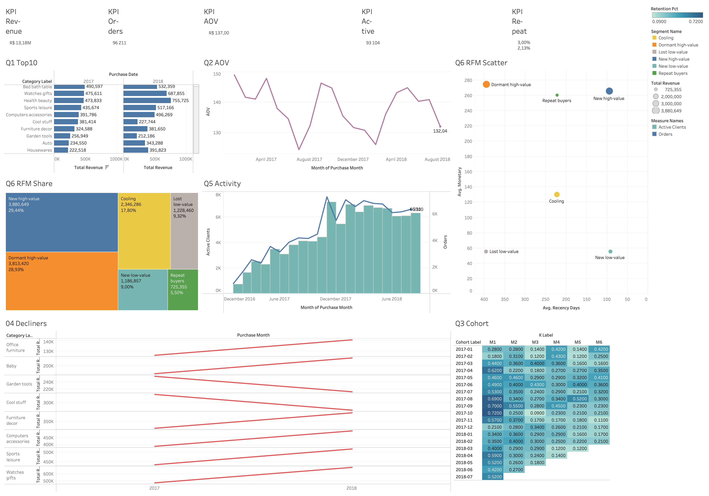

# E-commerce Data Analytics: Olist + PostgreSQL + Tableau Public

Сквозной аналитический проект по данным бразильского маркетплейса Olist: от сырых CSV до интерактивного дашборда и бизнес-рекомендаций.

## Цель

Проанализировать продажи и выручку, найти драйверы роста, проблемные категории и перспективные клиентские сегменты и по каждому выводу предложить действие бизнесу.

Ответы на шесть бизнес-вопросов:

1. Какие категории приносят наибольшую выручку?
2. Как меняется средний чек?
3. Какие клиенты чаще возвращаются?
4. Какие категории снижают продажи?
5. Как меняется покупательская активность?
6. Какие клиентские сегменты наиболее перспективны?

## Данные

**Brazilian E-Commerce Public Dataset by Olist** (Kaggle). Использованы 6 из 9 таблиц: customers, orders, order_items, payments, products, product_category_name_translation. Таблицы sellers, reviews и geolocation в анализ не входят. Условия лицензии указаны на странице датасета на Kaggle, при публикации проекта сохраните ссылку на источник.

Почему Olist, а не Online Retail II: в Olist есть категории товаров (без них нельзя ответить на вопросы 1 и 4), а реляционная структура хорошо подходит для SQL-анализа.

| Параметр                                            | Значение         |
| ----------------------------------------------------------- | ------------------------ |
| Всего заказов в исходных данных  | 99 441                   |
| Заказов `delivered`                                | 96 478 (97.02%)          |
| `canceled` + `unavailable`                              | 1 234 (1.24%)            |
| Период анализа                                 | 2017-01-01 … 2018-08-31 |
| Заказов `delivered` в периоде              | 96 211                   |
| Клиентов в периоде (`customer_unique_id`) | 93 104                   |

Период обрезан по границам, где данные устойчивы: в 2016 году всего 267 доставленных заказов, из них 265 в октябре.

## Стек

Python 3.11+, Pandas, NumPy, SQLAlchemy + psycopg2, PostgreSQL 16 (Docker), Jupyter, Git, Tableau Desktop Public Edition + Tableau Public.

## Структура репозитория

```
ecommerce-analytics/
├── data/raw/               # исходные CSV Olist (не в git)
├── data/processed/         # очищенные данные, RFM, когорты (не в git)
├── data/tableau/           # звёздная схема для Tableau
│   ├── fact_sales.csv
│   ├── dim_customer.csv
│   ├── dim_category.csv
│   ├── dim_date.csv
│   └── agg_cohort_retention.csv
├── notebooks/
│   ├── 01_data_audit.ipynb
│   ├── 02_cleaning.ipynb
│   ├── 03_eda.ipynb
│   ├── 04_rfm_cohorts.ipynb
│   └── 05_tableau_exports.ipynb
├── sql/
│   ├── 01_schema.sql
│   ├── 02_load_validation.sql
│   ├── 03_revenue_by_category.sql    # Q1
│   ├── 04_aov_dynamics.sql           # Q2
│   ├── 05_returning_customers.sql    # Q3
│   ├── 06_rfm.sql                    # Q6
│   ├── 07_category_decline.sql       # Q4
│   └── 08_activity_dynamics.sql      # Q5
├── src/
│   ├── clean.py
│   ├── load_to_postgres.py
│   └── export_to_tableau.py
├── tableau/
│   ├── dashboard_link.md
│   └── screenshots/
├── reports/figures/
├── docker-compose.yml
├── requirements.txt
└── README.md
```

## Этапы работы

1. **Аудит данных.** Shape, dtypes, пропуски, дубликаты, диапазон дат, статусы, отрицательные значения, целостность связей, сравнение трёх определений выручки.
2. **Очистка (`src/clean.py`).** Строки не удаляются «на всякий случай»: вместо этого ставятся флаги. Все правила логируются в `cleaning_log.txt`, итоговая выручка сверяется с аудитом до цента.
3. **Загрузка в PostgreSQL.** Схема с первичными ключами и `CHECK`, загрузка через `COPY`, сверка числа строк и выручки между Python и SQL.
4. **SQL-анализ.** Отдельный файл на каждый бизнес-вопрос, с CTE и оконными функциями.
5. **RFM и когорты в Python.** Результат полностью воспроизводит SQL (сверка по клиентам и до цента).
6. **Звёздная схема и выгрузка в `data/tableau/`.** Скрипт записывает CSV только если прошли все сверки с pandas и PostgreSQL.
7. **Дашборд в Tableau Public.**
8. **README и рекомендации.**

### Правила очистки

| Находка                                                                                                                        | Решение                                                                                                                |
| ------------------------------------------------------------------------------------------------------------------------------------- | ----------------------------------------------------------------------------------------------------------------------------- |
| 610 товаров (1 603 позиции, 1.42%) без категории                                                            | Категория `unknown`, выручка сохраняется                                                         |
| 2 категории без английского перевода (`pc_gamer`, `portateis_cozinha_e_preparadores_de_alimentos`) | Ручной перевод                                                                                                   |
| 775 заказов без позиций                                                                                              | Остаются в `orders` для анализа статусов (603 `unavailable`, 164 `canceled`, 8 прочих) |
| 8 `delivered` без даты доставки                                                                                      | Выручка сохранена, помечены флагом `delivery_date_missing`                                    |
| Дубликаты позиций, битые связи, `price <= 0`                                                              | Не найдены, защитные проверки оставлены в коде                                         |
| 9 платежей с `payment_value <= 0`                                                                                          | Оставлены, платежи используются только для сверки                                  |
| `customer_id` уникален на заказ                                                                                      | Для клиентов, RFM и когорт используется `customer_unique_id`                                  |

## Определения метрик

| Метрика                            | Определение                                                                                                                                                            |
| ----------------------------------------- | --------------------------------------------------------------------------------------------------------------------------------------------------------------------------------- |
| **Revenue**                         | `SUM(price)` по заказам `delivered` в периоде, без доставки                                                                                       |
| **Orders**                          | `COUNT(DISTINCT order_id)`                                                                                                                                                      |
| **AOV**                             | Revenue / Orders                                                                                                                                                                  |
| **Активные клиенты** | `COUNT(DISTINCT customer_unique_id)`                                                                                                                                            |
| **Repeat Purchase Rate**            | Доля клиентов с 2+ заказами в периоде                                                                                                                |
| **Repeat rate после 24 ч**    | Доля клиентов, чей последний заказ позже первого минимум на сутки (исключает «разбитые корзины») |
| **Retention M_k**                   | Доля клиентов когорты, сделавших заказ в k-м месяце после месяца первого заказа                                  |

Для проверки: `SUM(price + freight_value)` по delivered равна 15 419 773.75, `SUM(payment_value)` равна 15 422 461.77 (расхождение 0.017%).

## Ключевые метрики

| Метрика                  | Значение                          |
| ------------------------------- | ----------------------------------------- |
| Revenue                         | R$ 13 181 027.13                          |
| Orders                          | 96 211                                    |
| AOV                             | R$ 137.00 (медиана 86.50, p90 269) |
| Активные клиенты | 93 104                                    |
| Repeat Purchase Rate            | 3.00% (2 789 клиентов)            |
| Repeat rate после 24 ч    | 2.13% (1 984 клиента)              |
| Retention M1 / M3 / M6          | 0.48% / 0.26% / 0.23%                     |
| Доля delivered / отмен | 97.02% / 1.24%                            |

**Про конверсию.** В Olist нет данных о сессиях, просмотрах и корзине, поэтому конверсию посчитать нельзя, и она не придумывалась. Вместо неё анализируются доля успешных заказов и доля отмен.

## Дашборд в Tableau

Дашборд  находится в репозиторий в tableau (файл в формате **`.twbx`**.) Платформа работает только с файлами и не подключается к PostgreSQL, поэтому все агрегаты готовятся в SQL и Pandas и выгружаются в `data/tableau/`.

>
> ```
> 
> ```

### Звёздная схема

| Файл                     | Гранулярность                                                                      | Строк |
| ---------------------------- | ----------------------------------------------------------------------------------------------- | ---------- |
| `fact_sales.csv`           | позиция заказа (delivered, период анализа)                            | 109 880    |
| `dim_customer.csv`         | клиент (RFM-сегмент, флаги повторных покупок, когорта) | 93 104     |
| `dim_category.csv`         | категория (выручка, ранг, динамика 3 мес.)                       | 74         |
| `dim_date.csv`             | день                                                                                        | 608        |
| `agg_cohort_retention.csv` | когорта × месяц (для тепловой карты)                               | 210        |

### Состав дашборда

| # | Визуализация                                                                          | Бизнес-вопрос |
| - | ------------------------------------------------------------------------------------------------- | ------------------------- |
| 1 | KPI-карточки: Revenue, Orders, AOV, Repeat Purchase Rate, активные клиенты | общий обзор     |
| 2 | Bar chart: Top-10 категорий по выручке                                          | Q1                        |
| 3 | Line chart: AOV по месяцам                                                               | Q2                        |
| 4 | Heatmap: retention по когортам                                                          | Q3                        |
| 5 | Treemap или bar: RFM-сегменты по доле выручки                             | Q6                        |
| 6 | Line/bar: категории с падением продаж                                     | Q4                        |
| 7 | Line: активные клиенты и заказы по месяцам                         | Q5                        |
| 8 | Scatter или table: перспективные RFM-сегменты                             | Q6                        |

Фильтры: период, категория, RFM-сегмент (через Dashboard Actions).

**Что учитывать при чтении дашборда:**

- Тепловая карта когорт построена на отдельном агрегате: фильтры категории и RFM-сегмента на неё не действуют.
- Флаги повторных покупок и RFM-сегменты рассчитаны по всему периоду и не пересчитываются при фильтре по датам.
- Окно «падение категорий» фиксировано (март–май против июня–августа 2018) и тоже не зависит от фильтра по датам.
- AOV с фильтром по категории означает выручку категории на заказ, где она есть, а не стоимость всего заказа.

## Выводы и рекомендации

Каждый вывод оформлен по схеме: факт → гипотеза → действие → метрика контроля. Гипотезы в данных не проверяются, они помечены как гипотезы.

### Q1. Выручка по категориям

- **Факт:** топ-5 категорий дают 39.88% выручки, топ-10 дают 62.47%. Лидеры: `health_beauty` (9.33%), `watches_gifts` (8.83%), `bed_bath_table` (7.76%), `sports_leisure` (7.23%), `computers_accessories` (6.74%). Модели разные: `bed_bath_table` продаёт 9 267 заказов со средней ценой позиции R$ 93, `watches_gifts` продаёт 5 491 заказ по R$ 199. Категория `unknown` занимает 1.29% выручки.
- **Гипотеза:** одни категории растут на объёме, другие на цене, и стратегии у них должны быть разными.
- **Действие:** сосредоточить рекламу и ассортимент на топ-10, анализировать «объёмные» и «дорогие» категории раздельно. Привести в порядок разметку товаров без категории.
- **Метрика контроля:** доля топ-10 в выручке, доля `unknown`.

### Q2. Средний чек

- **Факт:** AOV держится в коридоре R$ 124–149 без устойчивого тренда. Среднее (137.00) на 58% выше медианы (86.50), на заказ приходится 1.11–1.16 позиции. Падение выручки в июне–августе 2018 к марту–маю 2018 (−11.77%) складывается из падения заказов на 9.4% (20 550 → 18 609) и падения AOV на 2.6% (141.34 → 137.71).
- **Гипотеза:** чек определяется ценой одной позиции и миксом категорий, а не размером корзины. Просадка AOV в ноябре 2017 (−6.4% при пике заказов) может быть связана с акциями, но в данных акций нет.
- **Действие:** цель «поднять AOV через корзину» не оправдана, корзина почти всегда из одной позиции. Тестировать бандлы, блок «с этим покупают» и порог бесплатной доставки. Главный рычаг роста сейчас в числе заказов.
- **Метрика контроля:** AOV и медианный заказ, позиций на заказ, доля заказов с 2+ позициями.

### Q3. Какие клиенты возвращаются

- **Факт:** 97.00% клиентов купили один раз. Repeat Purchase Rate равен 3.00%, без «разбитых корзин» 2.13%. 30.5% вторых заказов сделаны в течение суток. Среди вернувшихся медиана до второго заказа 29 дней, 50.5% вернулись за 30 дней, 75% за 125 дней. Retention M1 = 0.48%, дальше держится на 0.2–0.25%.
- **Категории первого заказа** (база от 1 000 клиентов): выше среднего `fashion_bags_accessories` (5.63%), `furniture_decor` (4.63%), `bed_bath_table` (4.43%), `sports_leisure` (3.80%). Ниже `electronics` (1.63%), `cool_stuff` (1.85%), `auto` (2.00%), `watches_gifts` (2.11%). Значимы в основном крайние значения, середина списка в пределах шума.
- **Связь со стоимостью первого заказа практически отсутствует:** доля повторных по квартилям 3.15% → 3.13% → 2.90% → 2.81%.
- **Гипотеза:** магазин живёт привлечением, возврат клиентов близок к фоновому уровню. `watches_gifts` и `electronics` могут быть разовыми подарочными покупками.
- **Действие:** считать повтором заказ не раньше чем через 24 часа. Тестировать касания после покупки в окне 1–30 дней (например, на 7-й и 21-й день) в категориях с высокой долей повторных. Для категорий с низкой долей вкладываться в привлечение, а не в удержание.
- **Метрика контроля:** retention M1 (база 0.48%), Repeat rate после 24 ч (база 2.13%), в разрезе категории первого заказа.

### Q4. Категории со снижением продаж

- **Факт:** июнь–август 2018 против марта–мая 2018: рынок −11.77%, из 31 категории с базой от R$ 20 тыс. упали 22. Наибольшие потери в рублях: `computers_accessories` (−69.8 тыс.), `sports_leisure` (−56.9 тыс.), `watches_gifts` (−53.7 тыс.), `baby` (−47.6 тыс.), `cool_stuff` (−46.5 тыс.). Растут `health_beauty` (+22.1%), `housewares` (+24.6%), `telephony` (+42.9%), `pet_shop` (+46.2%).
- **Про большие проценты:** `audio` (−71%) и `small_appliances_home_oven_and_coffee` (−64%) выглядят самыми проблемными, но это маленькие и скачкообразные категории (у `audio` выброс в марте 2018). В дашборде категории ранжируются по абсолютной потере, а не по проценту.
- **Гипотеза:** общий спад спроса или трафика (заказов стало на 9.4% меньше). Данных об источниках трафика нет, проверить это нельзя. Сезонность неизвестна: в данных только 20 месяцев.
- **Действие:** разобрать причины падения в первую очередь по `computers_accessories` и `sports_leisure` (ассортимент, цены, наличие, реклама). Для малых категорий смотреть скользящее среднее за 3 месяца, а не MoM.
- **Метрика контроля:** выручка категории за 3 месяца к предыдущим 3 месяцам и отставание от рынка (в п.п.).

### Q5. Покупательская активность

- **Факт:** активные клиенты выросли с 718 (январь 2017) до пика 7 183 (ноябрь 2017), затем держатся на плато 6.0–7.0 тыс. С января по август 2018 число активных клиентов снизилось с 6 974 до 6 310 (−9.5%). Заказов на клиента около 1.01. Доля «возвратных» клиентов в месяце выросла с 0.1% до 2–3%.
- **Гипотеза:** рост доли возвратных во многом механический (копится база прошлых покупателей), а не признак лояльности. Рост ноября 2017 (+62.6% к октябрю) похож на сезонную распродажу, но акций в данных нет.
- **Действие:** не интерпретировать рост доли возвратных как успех. Следить за новыми клиентами как основным источником роста и оценивать эффективность каналов привлечения.
- **Метрика контроля:** новые клиенты в месяц, заказов на клиента, доля клиентов со вторым заказом позже чем через 24 часа.

### Q6. RFM-сегменты

Снимок на 2018-09-01. Пороги относительные (квинтили по этим данным): «недавний» клиент купил не позже 179 дней назад, «high-value» потратил от R$ 109.90. Частота разбита на уровни 1 / 2 / 3+, потому что 97% клиентов купили один раз.

| Сегмент        | Клиентов | % клиентов | Выручка, R$ | % выручки | Средняя сумма, R$ |       |        |
| --------------------- | ---------------- | ------------------ | ----------------------------------------------------------------------- | ----- | ------ |
| 1. Repeat buyers      | 2 789            | 3.00               | 725 355                                                                 | 5.50  | 260.08 |
| 2. New high-value     | 14 611           | 15.69              | 3 880 649                                                               | 29.44 | 265.60 |
| 3. New low-value      | 21 511           | 23.10              | 1 186 857                                                               | 9.00  | 55.17  |
| 4. Cooling (1 order)  | 18 048           | 19.38              | 2 346 286                                                               | 17.80 | 130.00 |
| 5. Dormant high-value | 13 912           | 14.94              | 3 813 420                                                               | 28.93 | 274.11 |
| 6. Lost low-value     | 22 233           | 23.88              | 1 228 460                                                               | 9.32  | 55.25  |

- **Факт:** два сегмента с одним заказом и высокой суммой дают по ~29% выручки каждый: «New high-value» (давность в среднем 94 дня) и «Dormant high-value» (давность от 271 дня, в среднем 395). Повторные покупатели составляют 3.0% клиентов и 5.5% выручки. Их средняя сумма (R$ 260) почти равна сумме разового покупателя из «New high-value» (R$ 266).
- **Гипотеза:** повторный клиент не обязательно ценнее разового. Сегмент «Dormant high-value» фактически почти потерян: давность от 9 месяцев при единственной покупке.
- **Действие:** приоритет номер один «New high-value»: у них свежий контакт и высокий чек, а окно для второго заказа (см. Q3) ограничено первыми 1–125 днями. Для «Dormant high-value» только недорогие реактивационные кампании. Для «Lost low-value» (23.9% клиентов, 9.3% выручки) бюджет удержания не оправдан.
- **Метрика контроля:** доля клиентов «New high-value» со вторым заказом в течение 90 дней.

## Ограничения

- **Нет сессий, просмотров, корзины, затрат на привлечение.** Конверсия не рассчитывалась, нельзя оценить окупаемость каналов.
- **Нет данных о возвратах товаров.** Альтернативы: отмены и недоступные товары.
- **Нет данных об акциях и маркетинге.** Все объяснения пиков и спадов (Black Friday, сезонность) остаются гипотезами.
- **Короткий горизонт (20 месяцев).** Годовую сезонность оценить нельзя, поэтому сравнение «июнь–август к марту–маю» может частично отражать сезонность.
- **`customer_unique_id`** может не склеивать одного человека с разными контактами, тогда повторные покупки занижены. Проверить это нельзя.
- **Хвост retention шумный.** Для M9 и дальше число вернувшихся клиентов небольшое (десятки), M19 опирается на одного клиента. Достоверны значения M1–M6.
- **Revenue без доставки.** `price + freight` даёт R$ 15.42 млн, `payment_value` расходится с ним на 0.017% (R$ 2.7 тыс.).
- **Заказы по категориям нельзя складывать:** заказ с товарами из нескольких категорий учитывается в каждой.
- **Категория `unknown`** (1.29% выручки) не восстанавливалась.
- **Пороги RFM относительные** (квинтили), при другой выборке они изменятся.
- **Публичность:** Tableau Public не подходит для конфиденциальных данных. Датасет открытый, `customer_unique_id` в нём уже обезличен. Перед публикацией проверьте настройку скачивания данных зрителями.

## Как запустить проект

Требования: Python 3.11+, Docker, `psql` (или `docker exec`, как ниже).

```bash
# 0. Окружение
python -m venv .venv && source .venv/bin/activate
pip install -r requirements.txt

# 1. Скачать датасет Olist с Kaggle и положить все CSV в data/raw/

# 2. PostgreSQL
docker compose up -d

# 3. Очистка и загрузка (все команды запускать из корня репозитория)
python src/clean.py
python src/load_to_postgres.py

# 4. SQL-анализ. Порядок важен: файлы 05 и 06 создают представления
#    v_client_orders и v_rfm, которые использует сверка на шаге 6.
for f in 02_load_validation 03_revenue_by_category 04_aov_dynamics \
         05_returning_customers 06_rfm 07_category_decline 08_activity_dynamics; do
  echo "=== $f ==="
  docker exec -i ecommerce_pg psql -U analyst -d ecommerce < sql/$f.sql
done

# 5. RFM и когорты: выполнить notebooks/04_rfm_cohorts.ipynb
#    (создаёт data/processed/rfm.csv и cohort_retention.csv; рабочая папка = корень репозитория)

# 6. Экспорт для Tableau + сверка с PostgreSQL
python src/export_to_tableau.py
```

Скрипт экспорта записывает CSV только если все сверки прошли (используйте `--no-sql`, чтобы пропустить проверки в PostgreSQL).

Если порт 5432 занят, измените его в `docker-compose.yml` (например, `5433:5432`) и задайте `PG_PORT=5433`. Учётные данные по умолчанию (`analyst` / `analyst_pwd`) подходят только для локальной учебной базы.

Рекомендуемый `.gitignore`: `data/raw/`, `data/processed/`, `.venv/`, `.ipynb_checkpoints/`, `__pycache__/`. Размер CSV в `data/tableau/` около 34 МБ, их можно либо коммитить, либо оставить в `.gitignore`: они воспроизводятся скриптом экспорта.

### Проверки целостности

| Что сверяется                                                                       | Где                             |
| ----------------------------------------------------------------------------------------------- | ---------------------------------- |
| Выручка после очистки = аудит                                           | `src/clean.py`                   |
| Row counts и выручка Python = PostgreSQL                                                | `src/load_to_postgres.py`        |
| RFM и когорты Python = SQL                                                              | `notebooks/04_rfm_cohorts.ipynb` |
| Итоги, категории, месяцы, RFM, Repeat rate: CSV для Tableau = PostgreSQL | `src/export_to_tableau.py`       |

## Next steps

- Проверить эффект посткупочных касаний A/B-тестом (окно 1–30 дней).
- Добавить анализ отзывов (`review_score`) и сроков доставки как возможных факторов возврата клиентов.
- Оценить CLV и сравнить сегменты по ожидаемой ценности.
- Построить прогноз выручки с сезонностью (нужен больший горизонт данных).
- Добавить анализ по регионам и продавцам (таблицы customers, sellers, geolocation).
- Разобраться с категорией `unknown` и восстановить разметку.
